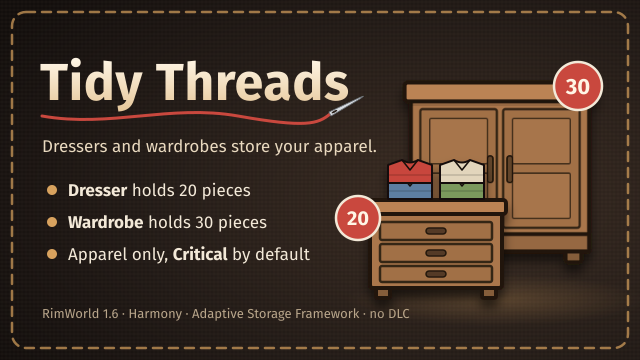

# Tidy Threads (RimWorld mod)



Dressers and wardrobes become apparel storage. Colonists put clothes away in them instead of leaving them on the
floor or in the general stockpile.

Source code: <https://github.com/jtj9817/tidy-threads>

| Furniture | Holds | Size | Where it comes from |
| --- | --- | --- | --- |
| **Dresser** | 20 pieces of apparel (10 per cell) | 2×1 | Every vanilla dresser, including those already in your save |
| **Wardrobe** | 30 pieces of apparel (15 per cell) | 2×1 | Vanilla Furniture Expanded's wardrobe when that mod is active, otherwise this mod's own |

- **Apparel only.** The storage filter is locked to Apparel: clothing, armor, headgear and utility items such as
  shield belts. Tainted and damaged apparel is accepted by default; you can narrow the filter further.
- **Critical by default.** New dressers and wardrobes start at Critical priority, so apparel moves out of shelves and
  stockpiles into them. You can lower the priority of any one of them, and that choice survives saving and loading.
- **Linkable.** Dressers and wardrobes link with each other (not with shelves) to share one storage setting; a linked
  group holds the sum of its members.
- **Tidy look.** Stored apparel isn't drawn on top of the furniture.
- **Everything else stays vanilla.** The dresser keeps its cost, research (Complex furniture), quality, art, beauty and
  its +0.05 bed comfort. Our wardrobe has the same comfort bonus. A room with a bed is still a bedroom; a room with
  only dressers and wardrobes counts as a storeroom.
- **Existing saves.** Add the mod to a running colony: dressers already built are converted on load, keeping their
  position, rotation, material, hit points, quality and art, and start at Critical with the Apparel filter.
- **Uninstalling, deconstructing or losing** a dresser or wardrobe (fire, raids, roof collapse) empties it first: its contents drop next to it, or at the
  nearest free spot on the map when everything nearby is full. Nothing is deleted.

### Our wardrobe and Vanilla Furniture Expanded

Without Vanilla Furniture Expanded (VFE) the mod adds its own wardrobe, under Architect › Furniture after Complex
furniture research: 70 stuff (wood, metal or stone), 2,600 work, 150 HP, beauty 6, with its own art. With VFE active,
only VFE's wardrobe exists and the mod turns it into storage instead; there is never a second wardrobe in the menu.

Both share VFE's def name (`Table_Wardrobe`), so you can add or remove VFE from a save: built wardrobes, their
contents and their priority carry over. After removing VFE, the game logs warnings about VFE data it can no longer
read. Those come from VFE's own leftovers in the save and are harmless for the wardrobes.

## Requirements

- RimWorld **1.6** (developed against `1.6.4871`). No DLC required.
- [Harmony](https://steamcommunity.com/sharedfiles/filedetails/?id=2009463077)
- [Adaptive Storage Framework](https://steamcommunity.com/sharedfiles/filedetails/?id=3033901359) (ASF), which
  provides the storage itself. Load it before Tidy Threads.
- Optional: [Vanilla Furniture Expanded](https://steamcommunity.com/sharedfiles/filedetails/?id=1718190143).

**Incompatible:** Dressers Hold Clothing (Continued) (`Mlie.DressersHoldClothing`). Both change the dresser; use one.

## Installing

The mod isn't on the Steam Workshop. Get it from the [GitHub repository](https://github.com/jtj9817/tidy-threads):
build it from source (see [Building](#building)), or download a packaged release from the
[releases page](https://github.com/jtj9817/tidy-threads/releases) if one is available. Then copy the packaged
`TidyThreads` folder (from `tools/package.sh`, in `dist/TidyThreads`) into the game's `Mods/` folder, enable
Harmony, Adaptive Storage Framework and Tidy Threads in that order, and restart. Adding it to an existing save is
safe.

> [!WARNING]
> **Removing Tidy Threads from a save is not supported.** The save stores dressers and wardrobes as storage, and
> without the mod they can error or lose their settings. Before removing it: uninstall or deconstruct every dresser
> and wardrobe (their contents drop to the floor), save, then disable the mod. Back up your save first.

## Building

Clone the [repository](https://github.com/jtj9817/tidy-threads). Building needs the `dotnet` SDK (targets `net472` via
`Krafs.Rimworld.Ref`), and Inkscape only to re-export textures.

```bash
tools/build.sh             # lint the Defs, build 1.6/Assemblies/TidyThreads.dll
tools/package.sh           # build + copy the release files to dist/TidyThreads
tools/export-textures.sh   # Art/**/*.svg → PNG textures, preview and mod icon
```

Development and testing notes are in [`AGENTS.md`](AGENTS.md), progress in [`TODO.md`](TODO.md), the design in
[`docs/plans/0001-tidy-threads.md`](docs/plans/0001-tidy-threads.md), and test runs in
[`docs/test-runs.md`](docs/test-runs.md).

## Repository layout

```text
About/              About.xml, preview image, mod icon
LoadFolders.xml     Loads NoVFE/ only while Vanilla Furniture Expanded is inactive
Defs/, Patches/     Always loaded: ASF graphics settings; the dresser and wardrobe storage patches
NoVFE/              Our wardrobe def, its bed-comfort link and its textures
1.6/Assemblies/     Compiled TidyThreads.dll (build output, git-ignored)
Source/TidyThreads/ C# project: converts pre-mod dressers; in-game test scenarios (dev builds)
Art/                SVG sources for every texture and the About images
tools/, docs/       Build, package and test tooling; design and method docs
```

## License

Tidy Threads is licensed under the [MIT License](LICENSE); the full text is included below.

**MIT License**

Copyright (c) 2026 jtj9817

Permission is hereby granted, free of charge, to any person obtaining a copy of this software and associated
documentation files (the "Software"), to deal in the Software without restriction, including without limitation the
rights to use, copy, modify, merge, publish, distribute, sublicense, and/or sell copies of the Software, and to
permit persons to whom the Software is furnished to do so, subject to the following conditions:

The above copyright notice and this permission notice shall be included in all copies or substantial portions of
the Software.

THE SOFTWARE IS PROVIDED "AS IS", WITHOUT WARRANTY OF ANY KIND, EXPRESS OR IMPLIED, INCLUDING BUT NOT LIMITED
TO THE WARRANTIES OF MERCHANTABILITY, FITNESS FOR A PARTICULAR PURPOSE AND NONINFRINGEMENT. IN NO EVENT SHALL THE
AUTHORS OR COPYRIGHT HOLDERS BE LIABLE FOR ANY CLAIM, DAMAGES OR OTHER LIABILITY, WHETHER IN AN ACTION OF
CONTRACT, TORT OR OTHERWISE, ARISING FROM, OUT OF OR IN CONNECTION WITH THE SOFTWARE OR THE USE OR OTHER
DEALINGS IN THE SOFTWARE.
